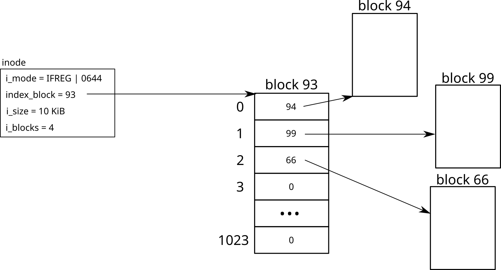
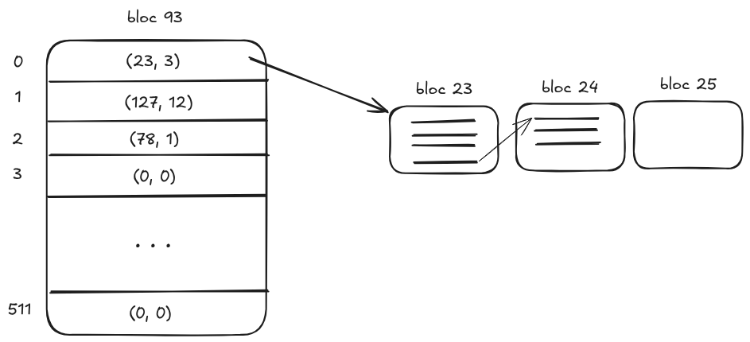

# Wishfs

## About

**Wishfs** is a modified version of the [ouichefs](https://github.com/rgouicem/ouichefs) Linux filesystem. In the original implementation, individual file sizes are capped at 4 MB due to the design of the index block. Wishfs removes this limitation by introducing an extent-based storage layout to support virtually infinite file sizes, trading off storage capacity under heavy fragmentation and raw I/O performance.

This repository provides a reproducible build environment containing a preconfigured Linux kernel tree, the filesystem module, and utilities to generate and test disk images.

### Repository Structure
* `ouichefs` - Filesystem source code, test suites, and image-creation utilities (see directory for component licenses).
* `Makefile` - Main build orchestration for the kernel, filesystem tools, and test images.
* `tests` - bash scripts to setup the filesystem and C programs to test the I/O operations

---

## How It Works

In the original `ouichefs` architecture, a file's data blocks are tracked as a flat list of individual block numbers stored inside a single fixed-size index block (see the [ouichefs README](./ouichefs/README.md) for full details):



**Wishfs** replaces this flat list with an **extent-based implementation**:



Instead of storing every individual block pointer, each entry in the index block is a struct containing:
1. **The starting block number** of a contiguous sequence.
2. **The number of contiguous blocks** that follow it.

When files are written contiguously, a single extent entry can represent a large span of data, allowing a single index block to address virtually unlimited file sizes.

---

## Known Limitations

* **Reduced I/O Performance (No Page Cache):** Because Wishfs relies on custom `read` and `write` implementations, file operations bypass the Linux kernel's page cache, significantly limiting read/write throughput.
* **Worst-Case Fragmentation Cap (2 MB):** Storing both a starting block number and a length doubles the size of each entry in the index block, halving the maximum number of entries it can hold. In the worst-case scenario where every extent is only 1 block long the maximum file size drops to half of the original `ouichefs` limit, capping out at **2 MB**.

---

## Prerequisites & Installation

### Prerequisites
Ensure the following tools and packages are installed on your build machine:
* **Build toolchain:** GNU `make`, `gcc`, and standard Linux kernel compilation dependencies.
* **Disk & archive utilities:** `dd`, `xz`, `cp`, `mkfs.ext4`, and `tune2fs`.
* **Filesystem formatter:** The `mkfs.ouichefs` binary (automatically compiled when building `ouichefs` via `make`).

### Building the Project
Clone the repository and run `make` from the root directory to compile the kernel, build the `ouichefs` module/tools, and generate the default disk images (`test.img`, `myHome.img`, and `pnl-tp-2021.img`):

```sh
make
```

---

## Usage & Configuration

### Make Targets

Run these commands from the repository root:

* `make` — Builds the kernel, `ouichefs` module/tools, and all disk images.
* `make kernel` — Compiles the Linux kernel inside `linux-6.5.7`.
* `make ouichefs` — Builds the `ouichefs` kernel module and user-space utilities.
* `make clean` — Cleans kernel build artifacts and removes temporary disk images.

### Configurable Variables

You can override the following `Makefile` variables via the command line:

* `nproc` *(default: output of `nproc`)* — Number of parallel jobs passed to `make -j`.
* `kdir` *(default: `./linux-6.5.7`)* — Path to the Linux kernel source tree.
* `ouichefsdir` — Path to the `ouichefs` subproject directory.
* `test_disk`, `home_disk`, `boot_disk` — Custom filenames for the generated disk images.

### Build Examples

Build only the kernel using 8 parallel jobs:

```sh
make kernel nproc=8

```

Generate only the test disk image using `ouichefs/mkfs/mkfs.ouichefs`:

```sh
make test.img

```

Clean build files and temporary images:

```sh
make clean

```

---

## Testing

1. **Boot the VM:** Launch the QEMU environment with your newly compiled kernel and disk images using the provided script on the host machine:
```sh
./qemu-run-externKernel.sh
```
*(This exposes the test disk image as `/dev/sdc` and mounts the shared project directory at `/share` inside the guest VM.)*

2. **Run the Test Suite:** Once logged into the VM, execute the test script located in `/share/run_tests.sh` (or run the commands manually) to load the module, mount the filesystem, and run the single-threaded, multi-threaded, and `ioctl` tests. (you can inspect and modify this script in `tests/run_tests.sh`) 
